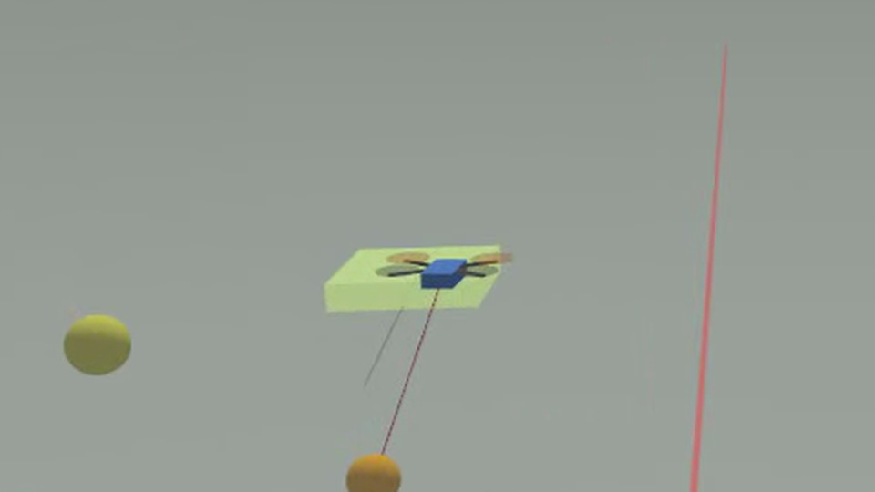

# gnss-imu-fusion

3d position estimation and short term position prediction for a raspberry pi
4 carrying a u-blox max-m10s gnss receiver and an xsens mti-630 imu. gps fixes
(1 hz) and imu acceleration (100 hz) are fused in a kalman filter, which
gives a smoother position and altitude than the raw receiver and predicts
where the device will be a moment later.


## how it works

```
max-m10s ── nmea (9600 baud) ──▶ rmc/gga parser ──▶ utm ──┐
                                                          ├──▶ queue ──▶ kalman filter ──▶ estimate + prediction
mti-630 ─── xbus (115200 baud) ─▶ mtdata2 parser ─────────┘
```

- **gps**: `$..rmc` sentences give position, speed and course; `$..gga`
  gives the altitude and the hdop, which sets how much each fix is trusted.
  each rmc is held until the gga of the same epoch arrives. sentences are
  checksum verified and converted to utm metres.
- **imu**: mtdata2 packets give the orientation quaternion and the
  acceleration (or the gravity free acceleration if enabled), rotated into
  the local east/north/up frame with gravity removed.
- **filter**: state is `[east, north, up, v_east, v_north, v_up]`. every imu
  sample predicts the state forward with the measured acceleration, every gps
  fix corrects it. nmea has no vertical velocity, so the climb rate comes from
  the accelerometer and the altitudes. fixes that disagree too much with the prediction are rejected
  (chi-square gate), and the filter restarts from gps if that keeps
  happening. without an imu it runs on gps alone.
- **prediction**: `position_estimator::predict_ahead(t)` extrapolates the
  current estimate `t` seconds ahead with the current acceleration.

## layout

| path | what |
|---|---|
| `includes/`, `src/` | the libraries: `time_and_location`, `rmc`, `utm`, `xbus`/`mti_630`, `gps`, `kalman` |
| `src/main.cpp` | the device program, prints the estimate as csv |
| `sim/` | gazebo simulations: worlds, bridge programs, gui overlay plugin, yolo detector |
| `test/cpp/` | unit tests |
| `test/python/` | serial capture script and a recorded nmea log |
| `docs/` | datasheets and papers used |

## building

needs cmake ≥ 3.22 and a c++20 compiler. boost (asio, headers only) is only
needed for the device program; without it the libraries and tests still
build.

```
mkdir build && cd build
cmake ..
cmake --build .
ctest
```

## running on the device

```
./build/src/main                                   # live: gps on uart0, imu on uart4
./build/src/main test/python/get_data/data.txt     # replay a recorded nmea log
```

output is csv on stdout: the estimate (lat/lon, altitude and utm), velocity,
uncertainty, the raw gps fix and the position predicted one second ahead.
if the imu port cannot be opened it runs on gps only. `docs/uart.sh` has the
notes for enabling the uarts on the pi.

for the best imu input, enable the free acceleration output in mt manager
and set the magnetic declination, otherwise north is magnetic north.

## simulation

a quadrotor takes off and flies a figure-eight in gazebo harmonic while its
speed swings between 1 and 4 m/s and its height between 5 and 11 m. it
carries a 100 hz imu and a 1 hz gps with 1.5 m of horizontal noise. the
flight is real multirotor physics: it tilts to accelerate, so the imu
orientation and the gravity removal are exercised. `positioning_sim` feeds
the sensors to the same `position_estimator` the device uses, draws the
prediction as a green "ghost" in front of the drone, and scores every
prediction against the true pose once the simulation reaches that moment.

```
distrobox enter gazebo -- sim/run.sh                                  # with the gazebo window
distrobox enter gazebo -- sim/run.sh --headless --duration 120        # terminal only
distrobox enter gazebo -- sim/run.sh --horizon 0.5 --gps-noise 3 --gps-drift 2
```

`run.sh` builds into `build-sim/`, starts gazebo and runs the bridge; ctrl-c
prints the summary. on fedora gazebo lives in the `gazebo` distrobox (ubuntu
24.04 with `gz-harmonic` from packages.osrfoundation.org). options:

| option | default | |
|---|---|---|
| `--horizon s` | 1.0 | how far ahead the ghost predicts (0.01 = next imu sample) |
| `--gps-noise m` | 1.5 | white gps position noise |
| `--gps-drift m` | 0 | slowly wandering gps error, like multipath |
| `--gps-vfactor f` | 1.7 | altitude noise and drift relative to the horizontal |
| `--accel-bias a` | 0.02 | accelerometer bias per axis, m/s², fixed at startup |
| `--tilt-error deg` | 0.2 | slowly wandering roll/pitch error of the imu orientation |
| `--heading-error deg` | 1.0 | slowly wandering heading error of the imu orientation |
| `--duration s` | forever | stop after this much simulated time |
| `--radius m` | 12 | figure-eight loop radius |
| `--altitude m` | 8 | cruise height above the ground |
| `--altitude-swing m` | 3 | how far it climbs and descends around the cruise height |
| `--manual` | | don't fly; command `/drone/cmd_vel` by hand (see `sim/gui.config`) |
| `--no-follow` | | don't move the camera with the drone |



what is drawn:

- **green box**: the predicted pose, turning yellow then red as the latest
  prediction error grows
- **orange sphere and red line**: where an earlier ghost said the vehicle
  would be now, and how far off it was
- **yellow dots**: the last 20 noisy gps fixes, at their noisy altitude
- **top left overlay**: live accuracy, from the accuracy overlay gui plugin
  in `sim/gui_plugin/`

### results

120 simulated seconds, 1.5 m horizontal and 2.55 m vertical gps noise, 1 s
horizon (metres):

| | 3d mean | 3d p95 | vertical mean |
|---|---|---|---|
| ghost (kalman prediction, 1 s ahead) | 2.04 | 4.56 | 1.84 |
| raw gps fix extrapolated 1 s with its own velocity | 3.33 | 7.04 | 2.29 |
| kalman estimate of the current position | 1.76 | 3.95 | 1.55 |
| raw gps fix | 3.21 | 6.66 | 2.28 |

mean is the typical error. p95 is the 95th percentile: 95% of the errors
were at or below it and only the worst 5% were above, so it shows how bad
the less common cases (sharp turns, sudden speed changes) get without being
set by a single outlier like the maximum is.

the extrapolated raw fix is given the true climb rate plus noise, which a
real nmea receiver does not report, so it is a generous comparison.

most of the error is vertical, because altitude is the noisiest measurement
and, unlike the horizontal axes, has no velocity measurement to help it.
with noise free gps the kalman altitude stays within about 0.1 m, so what
limits it is the gps altitude noise, not the imu or the prediction.

## pole tracking simulation

the same quadrotor is tracked from a pole beside its flight path. the pole
carries a uwb anchor (range, 20 hz) and a camera on a pan-tilt mount. a yolo
detector finds the drone in the camera image and each detection becomes a
bearing ray. `pole_tracking_sim` fuses the ranges and rays, optionally with
the drone's own imu and gps, and scores the estimate against the true pose.
the camera is turned towards the estimate (never the ground truth), slew
rate limited, so it keeps the drone in view. detections arrive late because
yolo takes time, so all measurements are buffered and fused in timestamp
order a fixed time behind the simulation.

the detector is trained once on images generated from simulated flights,
labelled from the true pose:

```
distrobox enter gazebo -- sim/detector/setup.sh     # yolo into build-sim/yolo-venv
distrobox enter gazebo -- sim/detector/train.sh     # dataset + training, writes build-sim/drone.pt
```

then:

```
distrobox enter gazebo -- sim/run_pole.sh                                # with the gazebo window
distrobox enter gazebo -- sim/run_pole.sh --headless --duration 120      # terminal only
distrobox enter gazebo -- sim/run_pole.sh --no-gps --no-imu              # camera and uwb only
```

`run_pole.sh` builds into `build-sim/`, starts gazebo with an extra panel
showing what yolo sees, runs the detector (`sim/detector/detect.py`) and the
bridge, which prints the fused error every second. gazebo and detector logs
go to `build-sim/gz.log` and `build-sim/detector.log`. the camera needs a
display even with `--headless`. `DETECTOR_IMGSZ` sets the yolo input size
(default 1280). options:

| option | default | |
|---|---|---|
| `--no-gps` | | don't use the gps |
| `--no-imu` | | don't use the imu |
| `--uwb-noise m` | 0.1 | uwb range noise |
| `--gps-noise m` | 1.5 | white gps position noise |
| `--latency s` | 0.4 | fuse measurements this far behind the simulation |
| `--duration s` | forever | stop after this much simulated time |
| `--radius m` | 8 | figure-eight loop radius |
| `--altitude m` | 8 | cruise height above the ground |
| `--altitude-swing m` | 3 | how far it climbs and descends around the cruise height |
| `--seed n` | 1 | noise seed |
| `--csv file` | | write the estimate and ground truth to a file |
| `--no-follow` | | don't move the gui camera with the drone |
| `--fixed-camera` | | keep the pole camera in its rest pose instead of turning it towards the drone |
| `--slew-rate deg` | 120 | pan-tilt speed limit, degrees per second |
